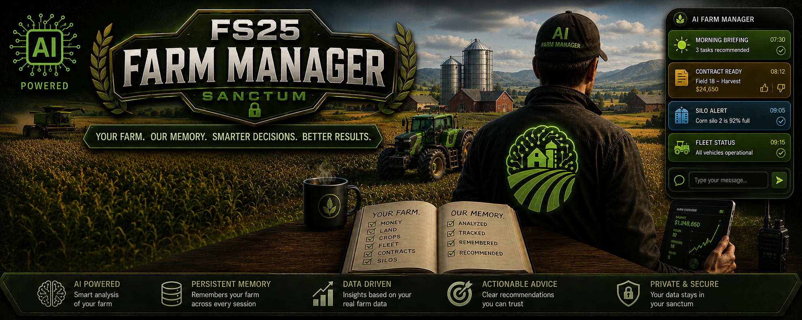
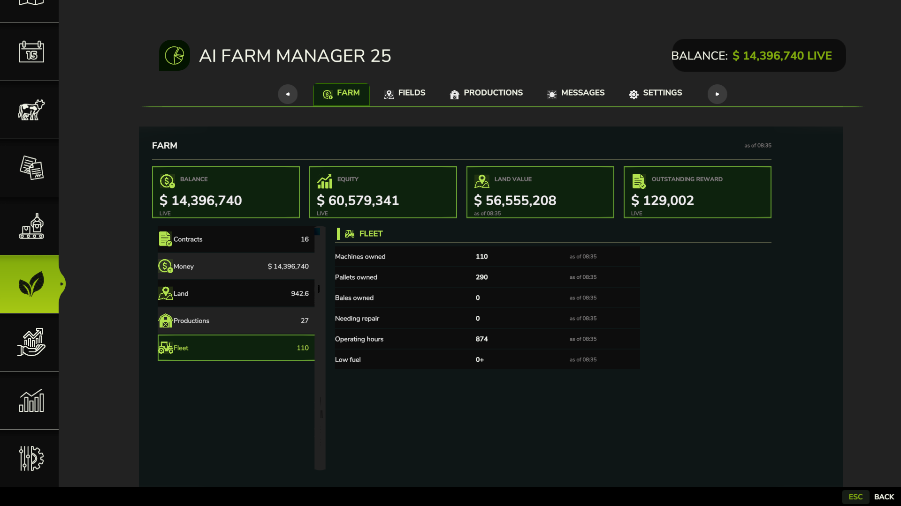

# FS25 Farm Manager

[](https://github.com/Hidden-History/FS25-AI-Farm-Manager/actions/workflows/test.yml)
[](https://github.com/Hidden-History/FS25-AI-Farm-Manager/actions/workflows/lint.yml)
[](LICENSE)

An AI farm manager for **one** Farming Simulator 25 savegame. It reads your save, remembers
your farm across sessions, and talks to you in Claude Code as **Cyrus**. With the mod
installed it also puts messages on your screen while you play, reads your answers back, and
adds a Farm Manager page to the game menu.

It is **read-only against your game**. It never writes to your savegame — not once, not ever.



```
┌──────┬──────────────────────────────┐
│ sun  │ MORNING BRIEFING       07:30 │
│      │ 3 tasks recommended          │
├──────┼──────────────────────────────┤
│ silo │ SILO ALERT             09:05 │
│      │ Corn silo 2 is 92% full      │
└──────┴──────────────────────────────┘
```

## What you get

- **Briefings**: what changed since last time, and what is worth doing today.
- **Advice with its reasons**: what each field needs, which production is running dry, what
  to buy and when, with real prices.
- **A page in the game menu** with five tabs: Farm, Fields, Productions, Messages, Settings.
- **Cards on screen you can answer** with a click or a typed reply.
- **A memory that is yours**: plain text files in a folder on your PC.

## New in 3.1.9.0

The first release since 3.0.0.0. The full list is in the [changelog](CHANGELOG.md).

- **The Farm Manager page in the game menu**, with five tabs. The Settings tab replaces the old
  settings window.
- **Figures say where they came from**: LIVE, or "as of" the time the manager read your save.
- **A crop plan and notes for each field**, shown on the Fields tab, and the crop plan is kept
  current as a standing duty.
- **How full each building is** when you ask the manager, and **each building's own capacity** on the Productions tab.
- **Planting windows and ready / dead dates** for each field, with the assumptions stated. On a save where crops do not grow by season, it says so.
- **Fuel alerts and the Low fuel count now agree**, and Machines, Pallets and Bales owned are
  separate lines.
- **Cards and replies are kept per savegame**, so each save shows only its own.
- **Fixed**: accepting a field contract no longer breaks it until you reload the save.

## What you need

- Farming Simulator 25 on PC.
- [Claude Code](https://claude.com/claude-code), and Python 3. No Python packages to install.
- **Windows with WSL.** macOS is untested.

## Quick start

1. **Install** the manager into a folder for your farm, and the mod into your FS25 `mods`
   folder. → [Install](docs/how-to/install.md)
2. **Set up your farm**: start Claude Code in that folder and say "set up my farm manager".
   → [Set up your farm](docs/how-to/set-up-your-farm.md)
3. **Play**: say "briefing" when you start and "close out" when you stop.
   → [Daily use](docs/how-to/daily-use.md)

The mod zip is also on [KingMods](https://www.kingmods.net/en/fs25/mods/79933/ai-farm-manager)
and on the [GitHub releases page](https://github.com/Hidden-History/FS25-AI-Farm-Manager/releases).
Use the mod and the manager from the same release.

## Documentation

| How to | |
|---|---|
| [Install](docs/how-to/install.md) | Both halves, first time |
| [Set up your farm](docs/how-to/set-up-your-farm.md) | What setup asks and what it creates |
| [Update](docs/how-to/update.md) | Move to a newer version |
| [Daily use](docs/how-to/daily-use.md) | What to say, and what you get |
| [The in-game menu](docs/how-to/in-game-menu.md) | The five tabs and where their numbers come from |
| [Reading the numbers](docs/how-to/reading-the-numbers.md) | What "unknown", "capacity refused" and "2+" mean |
| [Cards and replies](docs/how-to/cards-and-replies.md) | Answer a card; the three keys |
| [Run a second savegame](docs/how-to/second-savegame.md) | One farm folder per savegame |
| [Troubleshooting](docs/how-to/troubleshooting.md) | When what you see does not match |
| [Uninstall](docs/how-to/uninstall.md) | Remove it cleanly |

| Reference | |
|---|---|
| [Files on disk](docs/reference/files-on-disk.md) | Everything it writes, and where |
| [The notifier command](docs/reference/notify-cli.md) | Send a card yourself |
| [How it works](docs/reference/how-it-works.md) | The two halves and the loop between them |
| [Privacy and feedback](docs/reference/privacy-and-feedback.md) | What stays local; how to report a problem |

## How it behaves, and why

This exists because a farm manager that invents numbers is worse than none.

- **It reads, it doesn't guess.** Cash, land, fleet, prices, crop states, contracts — all
  come from your save. When something genuinely isn't on disk, it says so and asks.
- **It never writes to your savegame.** Its notes go in `sanctum/`; the mod's files go in
  the game's `modSettings` folder.
- **An empty answer is never reported as a fact.** "No land found" and "you own no land" are
  different claims, and the scripts keep them different.
- **A "no" has to be earned.** If a check has not confirmed something is absent, it says it
  does not know.
- **It tells you when it was wrong.** If a plan didn't work, it says so.

## Links

[Changelog](CHANGELOG.md) · [Issues](https://github.com/Hidden-History/FS25-AI-Farm-Manager/issues) ·
[KingMods](https://www.kingmods.net/en/fs25/mods/79933/ai-farm-manager) · [License](LICENSE)
