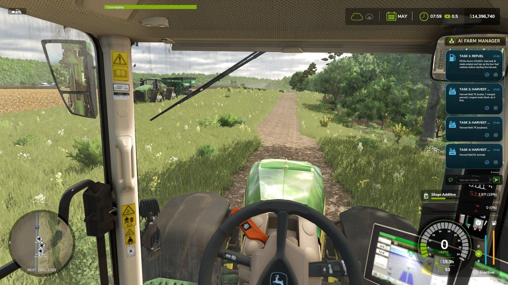

# Cards and replies

A **card** is a message the manager puts on your screen while you play. Some cards ask a
yes-or-no question or ask you to acknowledge, and your click goes back to the manager.

## The three keys

| Key | Does | Listed under Controls as |
|---|---|---|
| **Ctrl+Period** | Switches the panel between ON and OFF | AIFM: toggle panel |
| **Ctrl+Comma** | Brings the mouse cursor up or down so you can click a card | AIFM: toggle cursor |
| **Ctrl+Alt+Period** | Opens the game menu, where the Farm Manager page is | AIFM: settings |

All three can be changed under Controls.

## Answer a card

1. Press **Ctrl+Comma** to bring up the mouse cursor. The key works on foot and in a
   vehicle.
2. Click a button on the card. A card can carry:
   - a **check** to acknowledge
   - **thumbs up** and **thumbs down** for yes or no
   - both of the above
   - and always **✕** to dismiss
3. Press **Ctrl+Comma** again to put the cursor away.

These are the only buttons this version draws. A card cannot offer a list of options to
pick from.

## Type a reply

The **reply bar** is at the bottom of the panel, not on a card. Bring up the cursor and
click the bar. A text box opens: type a short message and confirm. A
typed reply goes to the manager as a message of its own; it is not attached to a particular
card, so say what you are answering.

With the cursor up you can also drag the panel to move it, and scroll it.

Your answer reaches the manager within moments if a session is running. A double-click
counts once.

## Panel ON and panel OFF

| Mode | What happens |
|---|---|
| **ON** (default) | The panel stays on screen. Cards wait until you answer or dismiss them. |
| **OFF** | Each card pops up, stays for a while, then fades. A card with buttons does not fade: it waits for your answer. |

Cards you have not answered are kept either way and are still there after you restart the
game. Every card is also listed in the [Messages tab](in-game-menu.md#messages-tab).

## Card colours

| Colour | Severity |
|---|---|
| Green | OK |
| Blue | Info |
| Amber | Warning |
| Red | Critical |

To see fewer cards, raise **Minimum severity** in the Settings tab.

## Change how the panel looks

Use the [Settings tab](in-game-menu.md#settings-tab): size, width, text size, opacity, how
long cards linger, and a button to reset the position.

There is also an optional `settings.xml` file. In practice the Settings tab replaces it:
see [Files on disk](../reference/files-on-disk.md#settingsxml-optional) for what it still
does.

## If a card looks like a plain grey game notification

The panel could not draw, so the mod used the game's own notification. You still got the
message. See [Troubleshooting](troubleshooting.md#a-card-shows-as-a-plain-grey-box).

## Each savegame has its own cards

Cards and answers are stored per savegame. Loading another savegame shows only that
savegame's cards.
