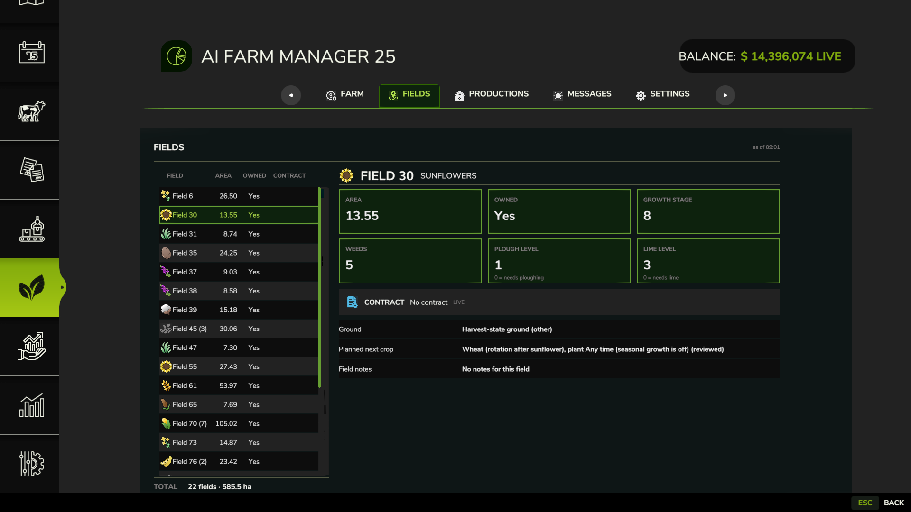
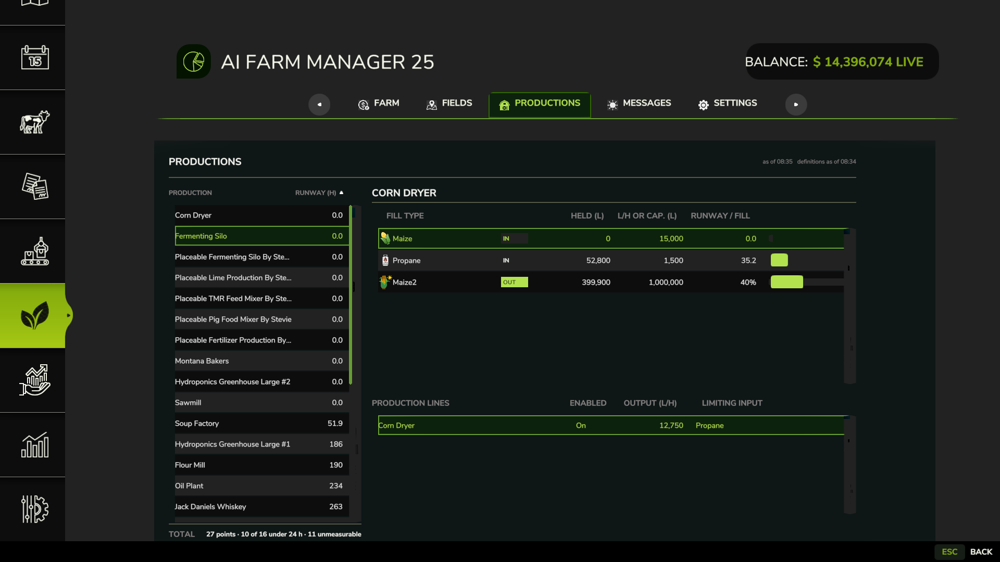
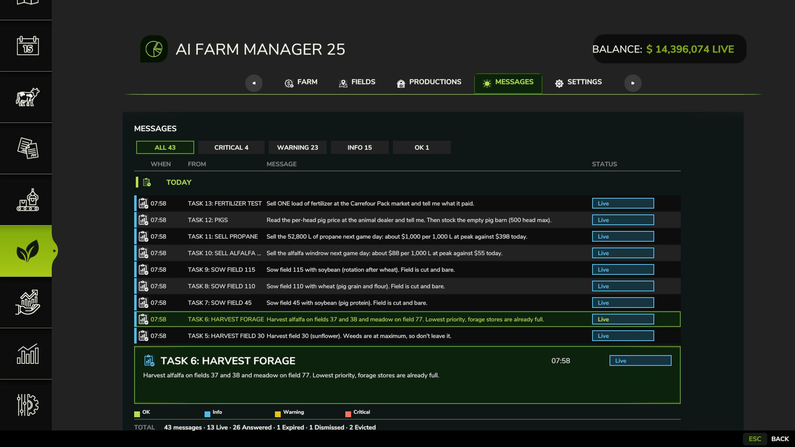
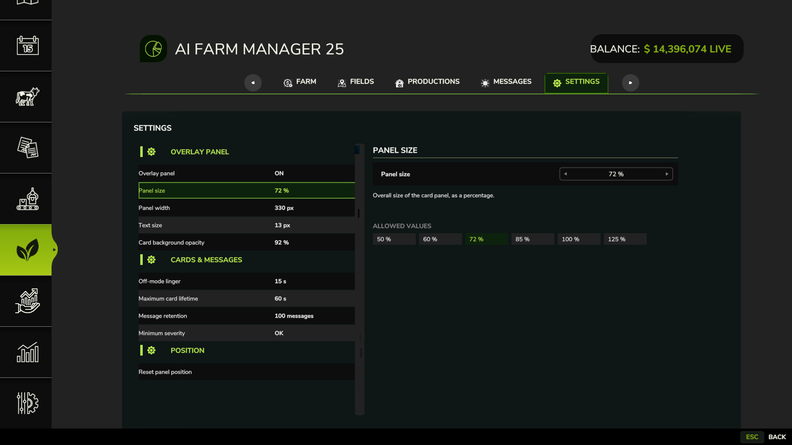

# The in-game menu

The mod adds an **AI Farm Manager 25** page to the game menu. It has five tabs: **Farm**,
**Fields**, **Productions**, **Messages** and **Settings**.

## Open it

- Open the game menu and pick the **AI Farm Manager 25** page, or
- press **Ctrl+Alt+Period**. This opens the game menu, on the Farm Manager page where it
  can; if it lands elsewhere, click the page. The key does nothing while another menu or
  dialog is already open.

You can change the key under Controls: it is listed as **AIFM: settings**.

## Where the numbers come from

There are two sources, and the page tells you which is which.

| Mark | Meaning |
|---|---|
| **LIVE** | Read from the running game right now. |
| **as of** *time* | Written by the manager the last time it read your save. |

The manager writes its figures when **you save the game while a manager session is
running**. No session, or no save since things changed, means those figures are old. The
"as of" time tells you how old. This is by design: an old number with its time on it is
honest; a guessed fresh one is not.

To refresh: start a session (`/farm-briefing`), save the game, and reopen the page.

## Farm tab

One line per figure, in five groups.

| Group | Lines | Source |
|---|---|---|
| Money | Balance, Loan, Equity, Daily loan interest | LIVE |
| Land | Farmlands owned, Owned area (ha), Land value | as of |
| Productions | Production points, Storage fill, Points at capacity | as of |
| Contracts | Contracts offered or active, Outstanding reward, Nearest deadline, Overall completion | LIVE |
| Fleet | Machines owned, Pallets owned, Bales owned, Needing repair, Operating hours, Low fuel | as of |

## Fields tab

A list of fields with **Area (ha)**, **Owned** and **Contract**. Select a field to see its
detail:

- the crop, in words ("Oat"), or **No crop** for bare ground
- **Growth stage**, **Weeds**, **Plough level** and **Lime level**. For the last two,
  0 means the field needs ploughing or needs lime
- **Ground**: the ground state in words ("Ploughed", "Seedbed")
- a contract box: the contract's title and reward, or **No contract**
- for a field made of several savegame parcels, a **Merge** line saying how many parcels it
  sums
- **Planned next crop**: the crop the manager has planned for the field, marked "reviewed"
  or "not yet reviewed with you". A field with no plan says so. A plan the manager could not
  read says that, with the reason.
- **Field notes**: the notes kept for the field, or "No notes for this field". A note the
  manager could not read says that, with the reason.

## Productions tab

A list of your production buildings with **Runway (h)**: how many hours the production can
keep running on the inputs it holds. A runway of 0 means it is starved right now. Select one to see its lines. Each row is tagged **IN** or **OUT** and shows the
fill type, the rate in litres per hour or the capacity, and the runway or fill.

The footer counts how many of your production points are under the runway threshold.

## Messages tab

The cards the manager has sent you for this savegame, grouped by day. The
columns are **When**, **From**, **Message** and **Status**.

| Status | Meaning |
|---|---|
| Live | Still on the panel |
| Answered | You clicked an answer |
| Dismissed | You closed it |
| Expired | Its time ran out |
| Evicted | Pushed off the panel by newer cards |
| Native fallback | Shown as a plain game notification instead of a card |

Use the filter buttons to show one severity. Click the **When**, **From** or **Status**
heading to sort by it (the Message column does not sort). The Fields and Productions lists
sort by their headings too.

Two limits apply. Old messages are kept up to the **Message retention** setting (100 unless
you change it; Off keeps none). And a message that arrived while the panel could not draw
at all was shown by the game's own notification and is not listed here.

## Settings tab

| Setting | What it does | Values |
|---|---|---|
| Overlay panel | Shows or hides the on-screen card panel | ON, OFF |
| Panel size | Overall size of the panel | 50 % to 125 % |
| Panel width | Width of the panel | 260 px to 520 px |
| Text size | Size of the text in each card | 11 px to 20 px |
| Card background opacity | Lower is more see-through | 50 % to 100 % |
| Off-mode linger | How long a card stays up when the panel is OFF | 10 s to 60 s |
| Maximum card lifetime | The longest a card may stay when the panel is OFF. With the panel ON a card does not expire | 30 s to 300 s |
| Message retention | How many past messages the Messages tab keeps | Off, 25 to 200 |
| Minimum severity | The lowest severity shown on screen | OK, Info, Warning, Critical |
| Reset panel position | Moves the panel back to its default place | — |

## When a tab is empty

| You see | It means |
|---|---|
| "Field reporting is not available yet." | The manager has not written field data for this savegame. Start a session and save. |
| "Production reporting is not available yet." | The same, for productions. |
| "You own no fields." / "You own no production buildings." | The manager read your save and found none. |
| "No messages yet." | No card has been sent in this savegame. |

## A savegame with no farm folder

The **Fields** and **Productions** tabs say reporting is not available, and the "as of"
lines on the Farm tab read "unknown". The **Money** and **Contracts** lines on the Farm tab
still show figures, because they are LIVE from the game and need no manager. The on-screen
panel shows one notice card saying no manager is set up for this savegame, the first time
you load it; on later loads the panel is empty. All of that is correct. See [Run a second savegame](second-savegame.md).

## Multiplayer

If you join someone else's game, your PC has no savegame folder for it. The mod then does
not look for cards and cannot record a click or a typed reply, so the panel stays empty.
No manager can be bound to that game.

## Related

- [Reading the numbers](reading-the-numbers.md): what "unknown", "capacity refused" and
  "2+" mean
- [Troubleshooting](troubleshooting.md)
